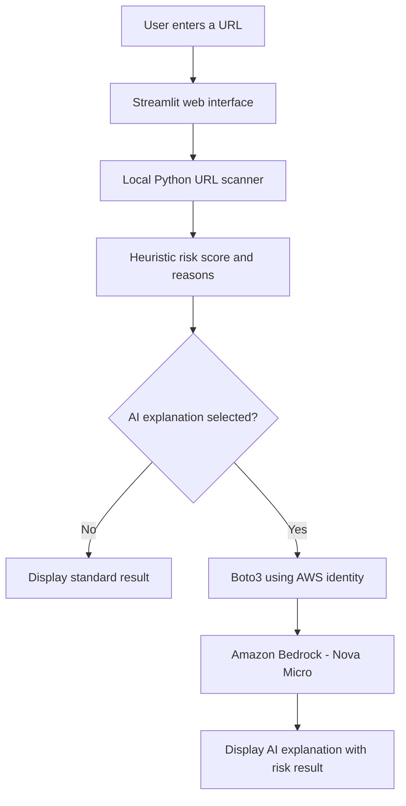

<div align="center">


### 🔐 Personal Hands-on AI and Cloud Cybersecurity Project

**Python-based URL risk analysis, with optional AI-generated explanations using Amazon Bedrock (Nova Micro).**

<p>
  
  
  
</p>

<table>
<tr>
<td align="center" width="33%"><a href="https://www.python.org/"></a><br /><strong>Python</strong></td>
<td align="center" width="34%"><a href="https://aws.amazon.com/bedrock/"></a><br /><strong>Amazon Bedrock</strong></td>
<td align="center" width="33%"><a href="https://streamlit.io/"></a><br /><strong>Streamlit</strong></td>
</tr>
</table>

**[📘 Full Project Documentation](./Final%20Documentation%20-%20AI-Assisted%20Phishing%20URL%20Risk%20Checker%20.pdf)** · **[📦 Original Starter Project ZIP](./File%20Structure%20%28Before%20the%20installations%29%20-%20AI-Assisted%20Phishing%20URL%20Risk%20Checker.zip)**

</div>

---

## 📖 Project Overview

Phishing messages often use misleading links to encourage unsafe actions. This educational application checks **URL structure** for suspicious indicators and shows an **explainable heuristic risk level**. When the user selects the AI option, **Amazon Bedrock** generates a plain-language explanation based on the scanner's findings.

**Two components:**
- **Part A — Local analysis:** Python + Streamlit; works without AWS.
- **Part B — Optional AI explanations:** Boto3 connects to Amazon Bedrock using securely configured AWS credentials.

> [!IMPORTANT]
> This is a **rule-based demonstration**, not a trained phishing classifier, a live URL reputation service, or proof that a website is safe. The application **does not visit or fetch the entered URL**. A low score does not guarantee safety; a high score can be a false positive.

## ✨ Features

- 🔎 Checks HTTP usage, IP-address hosts, URL user-information (`@`) patterns, unusually long hosts, deeply nested subdomains, unusual ports, Punycode, URL shorteners, and selected suspicious terms.
- 🚦 Presents **Low / Medium / High** risk labels and a transparent **0–100 heuristic score** (not a probability).
- 🧠 Optionally asks **Amazon Nova Micro** to explain findings and suggested precautions; the AI does **not** independently detect phishing.
- 🖥️ Interactive interface built with Streamlit.
- 🔐 Uses AWS CLI authentication, IAM permissions, and Boto3 instead of hardcoding secrets.
- 🧪 Includes tests for the URL scanner.

## 🏗️ Architecture



**AWS settings used by this project:**

| Setting | Value |
| :-- | :-- |
| Cloud provider | Amazon Web Services (AWS) |
| Source Region | `ap-southeast-1` (Singapore) |
| IAM user used for the demo | `phishing-bedrock-demo-user` |
| Foundation model | Amazon Nova Micro |
| Base model ID | `amazon.nova-micro-v1:0` |
| Runtime inference profile (APAC) | `apac.amazon.nova-micro-v1:0` (verify availability in your AWS account) |
| AI API | Amazon Bedrock Converse API via Boto3 |

The base model ID identifies Nova Micro, while the **APAC inference profile ID** is the value set as `BEDROCK_MODEL_ID` in this Singapore-based demo. AWS model and inference profile availability may change.

## 📁 Downloadable Files

| File | Description |
| :-- | :-- |
| [📘 Final project documentation (PDF)](./Final%20Documentation%20-%20AI-Assisted%20Phishing%20URL%20Risk%20Checker%20.pdf) | Full project report with architecture, implementation evidence, and AWS integration screenshots. |
| [📦 Original project file structure (ZIP)](./File%20Structure%20%28Before%20the%20installations%29%20-%20AI-Assisted%20Phishing%20URL%20Risk%20Checker.zip) | Pre-installation starter source: `app.py`, `scanner.py`, `ai_explainer.py`, `requirements.txt`, unit tests, and internal README. |
| `README.md` | This repository overview and setup guide. |

### Source code inside the starter ZIP

```text
phishing-url-detector/
├── app.py                 # Streamlit UI
├── scanner.py             # Offline URL-rule checks
├── ai_explainer.py        # Optional Bedrock Converse integration
├── requirements.txt       # Python dependencies
├── tests/
│   └── test_scanner.py    # URL scanner tests
└── README.md              # Starter setup notes
```

> The starter ZIP intentionally contains the **original project files before installation**. It does not include `.venv`, AWS credentials, installed libraries, or a preconfigured model session. `bedrock_smoke_test.py` shown in the final documentation is created during setup, so it is **not** included in the original starter ZIP.

## 🚀 Quick Start — Windows / VS Code

1. Download and extract the [starter source ZIP](./File%20Structure%20%28Before%20the%20installations%29%20-%20AI-Assisted%20Phishing%20URL%20Risk%20Checker.zip).
2. Open the extracted **`phishing-url-detector`** folder in VS Code.
3. Open **Terminal → New Terminal** (PowerShell), then run:

```powershell
py -3 --version
py -3 -m venv .venv
.\.venv\Scripts\Activate.ps1
python -m pip install -r requirements.txt
python -m streamlit run app.py
```

The browser should open at **http://localhost:8501**. If it does not, open that address manually.

> If PowerShell blocks activation, run `.\.venv\Scripts\python.exe -m pip install -r requirements.txt` followed by `.\.venv\Scripts\python.exe -m streamlit run app.py` instead. This avoids changing your execution policy.

### macOS / Linux

```bash
python3 -m venv .venv
source .venv/bin/activate
python -m pip install -r requirements.txt
python -m streamlit run app.py
```

### Example test URLs

| Test input | What it demonstrates |
| :-- | :-- |
| `https://www.python.org` | URL without matching demo flags; **not a safety guarantee** |
| `https://login-verify.example.net` | Credential-related terms in the hostname |
| `http://192.0.2.1/login` | HTTP, IP-based host, and credential-related path |
| `https://trusted.example@attacker.example/login` | Misleading user-information (`@`) structure |

Run the included tests from the extracted source folder:

```powershell
python -m unittest discover -s tests -v
```

## ☁️ Enable Amazon Bedrock AI Explanations (Optional)

> [!CAUTION]
> **AWS usage may incur charges.** Set AWS Budget alerts, use least-privilege IAM permissions, and stop the application when your demo is complete. Never commit AWS keys, `~/.aws`, `.venv`, or environment files to a public repository.

1. Install **AWS CLI v2** and configure an authorised identity with permission to use the Bedrock Converse API and the relevant inference profile. In the documented personal-account setup, the IAM username was `phishing-bedrock-demo-user`.
2. Confirm the account's Bedrock model and profile availability in Singapore:

```powershell
aws bedrock get-inference-profile --region ap-southeast-1 --inference-profile-identifier apac.amazon.nova-micro-v1:0
```

3. Sign in using your approved AWS CLI authentication flow. For AWS CLI browser-based sign-in, if you set up a named profile called `phishing-demo`:

```powershell
aws login --profile phishing-demo
aws sts get-caller-identity --profile phishing-demo
```

4. Set these variables **in the same PowerShell terminal** used to start Streamlit:

```powershell
$env:AWS_PROFILE="phishing-demo"
$env:AWS_REGION="ap-southeast-1"
$env:BEDROCK_MODEL_ID="apac.amazon.nova-micro-v1:0"
python -m pip install --upgrade boto3 awscrt
python -m streamlit run app.py
```

5. Tick **Add an Amazon Bedrock AI explanation**, enter a sample URL, and click **Analyse URL**.

If you authenticate with an AWS profile other than `phishing-demo`, replace the profile name above. If your account doesn't support `aws login`, use an approved alternative such as IAM Identity Center or another secure CLI credential method. The app requires **`bedrock:InvokeModel`** permission for the resources used by the selected profile; cross-Region inference can require access to multiple regional model resources.

For screenshots, AWS permissions, console actions, and troubleshooting, read the **[full documentation PDF](./Final%20Documentation%20-%20AI-Assisted%20Phishing%20URL%20Risk%20Checker%20.pdf)**.

## 🧰 Technology Stack

| Layer | Technologies |
| :-- | :-- |
| UI | Streamlit |
| URL inspection | Python, `urllib.parse`, `ipaddress` |
| AWS SDK | Boto3, AWS CRT |
| Optional generative AI | Amazon Bedrock, Amazon Nova Micro |
| Identity and deployment environment | AWS IAM, AWS CLI v2, VS Code / PowerShell |
| Cost monitoring | AWS Budgets (alerts, **not** automatic billing shutoff) |

## 🛡️ Security & Limitations

- The URL is parsed locally: **no URL fetch, DNS resolution, redirect follow, or external reputation lookup**.
- The optional AI request sends the **hostname, score, and matched heuristic findings**; it does not send the full URL's path and query. Avoid submitting private hostnames unless permitted.
- No machine-learning model is trained by this project. AI produces explanations, not the risk score.
- HTTPS alone does not prove a URL is legitimate; no URL-only heuristic is reliable enough for production decisions.
- The provided PDF may contain AWS Console or VS Code screenshots: **review and redact account identifiers or other sensitive details before publishing publicly**.

## 📚 References & Credits

- [Amazon Bedrock](https://aws.amazon.com/bedrock/) · [Amazon Nova Micro](https://docs.aws.amazon.com/bedrock/latest/userguide/model-card-amazon-nova-micro.html)
- [Boto3 Converse API](https://boto3.amazonaws.com/v1/documentation/api/latest/reference/services/bedrock-runtime/client/converse.html)
- [Streamlit documentation](https://docs.streamlit.io/)
- [skill-icons by tandpfun](https://github.com/tandpfun/skill-icons#readme) — Python icon
- [capsule-render by kyechan99](https://github.com/kyechan99/capsule-render) — animated README header and footer
- [AWS architecture icon mirror](https://github.com/jonrau1/ElectricEye) — Amazon Bedrock service icon
- [Simple Icons](https://simpleicons.org/) — Streamlit icon

**Project documentation:** © 2026 P.C.L.D. Jayathilake. All rights reserved, as noted in the included PDF. No standalone source-code license is supplied in this repository bundle.

<div align="center">


</div>
